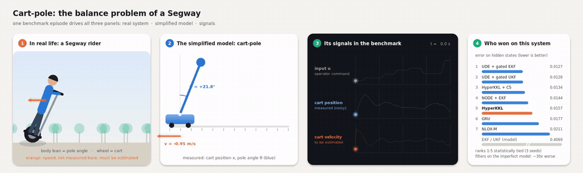
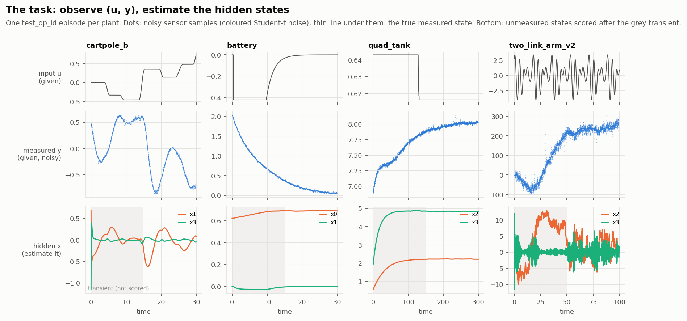
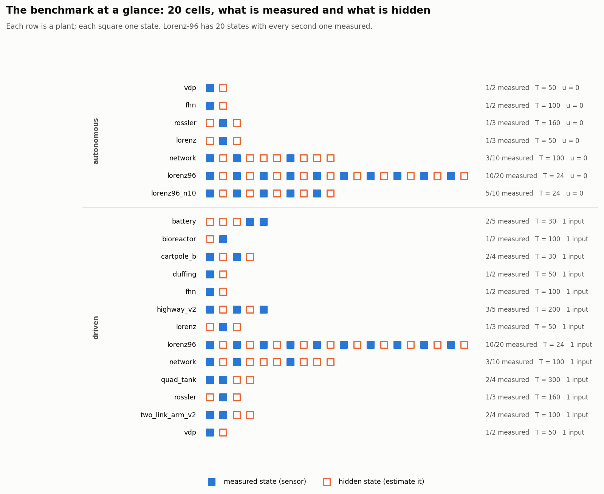

# HyperKKL (TMLR): learned KKL observers for autonomous and input-driven systems

This branch holds the code of the TMLR study of learned Kazantzis-Kravaris/Luenberger (KKL) observers for
input-driven systems, and **HyperKKL-Bench 2.0**, an open benchmark for state estimation. The study asks how a learned
KKL observer should use the input history, how much history it needs, and how far it generalises; the benchmark
compares it on equal data with learned-dynamics filters, recurrent networks, published learned KKL observers and
classical filters.

<p align="center"></p>

## The task

From an input record `u` and noisy measurements `y`, reconstruct the states that are not measured.

<p align="center"></p>

## HyperKKL in one paragraph

A KKL observer filters the measurements through a fixed, stable linear latent system and maps the latent state back
to the plant state with a learned decoder. HyperKKL conditions that decoder on the input history: a fading-memory
summary of `u` drives a low-rank (LoRA) hypernetwork that adapts the decoder weights. The default recipe is **A3 +
mixed histories**: SOAP optimiser, base decoder fine-tuned in phase 2, a strided window of past latent states as extra
context, and training on mixed operating-profile and event-structured input sequences
([`hyperkkl_bench/archive/A3_recipe.yaml`](hyperkkl_bench/archive/A3_recipe.yaml)). A smoothness regulariser (C5) is
available as an ablation.

## HyperKKL-Bench 2.0

<p align="center"></p>

* **Autonomous family** (u = 0): vdp, fhn, rossler, lorenz, a 10-state FitzHugh-Nagumo network, Lorenz-96 with 20 and
  10 states.
* **Driven family**: battery, bioreactor, cart-pole, fhn, highway, lorenz, Lorenz-96, network, quadruple tank,
  rossler, two-link arm, vdp, driven by realistic operator profiles, with an imperfect model (one missing physical
  term, 30 % parameter mismatch) and coloured heavy-tailed sensor noise.
* Test tiers for a different operator, the legacy v1 input tiers, initial-condition and parameter shift, hidden test
  sets, and robustness conditions (outliers, sensor outages, poor initialisation, quantised or commanded input
  records).
* Real-data tracks (two battery datasets, EMPS, Silverbox and others), fetched from their providers.

Data: [huggingface.co/datasets/Yahias21/HyperKKL-benchmark](https://huggingface.co/datasets/Yahias21/HyperKKL-benchmark).
Package, protocol and data cards: [`hyperkkl_bench/`](hyperkkl_bench/) (MIT licence).

## Reference results (equal data, seeds 0-2)

Settled NRMSE of the unmeasured states; driven `test_op_ood` / clean (12 cells), autonomous `test_id` / clean (7 cells).
Full tables, paired tests and robustness: [`experiments/bench_v2/RESULTS.md`](experiments/bench_v2/RESULTS.md).

| | driven: best in | driven: vs HyperKKL (better / tie / worse) | autonomous: best in |
|---|---|---|---|
| HyperKKL (default) | 4 of 12 (fhn, lorenz, rossler, vdp) | | 0 of 7 (C5 ablation: 2) |
| UDE (32-step) + gated UKF | 5 of 12 (with the 1-step UDE) | 1 / 8 / 3 | 5 of 7 |
| NODE + EKF | 1 of 12 (highway) | 1 / 9 / 2 | - |
| GRU | 1 of 12 (two-link arm) | 2 / 0 / 10 | 0 of 7 |
| NLOX-M (learned KKL) | 0 | 0 / 4 / 8 | 0 of 7 |
| DKKL (learned KKL) | 0 | 1 / 0 / 11 | 0 of 7 |
| EKF / UKF on the imperfect model | 0 | 20-30x worse | 0 of 7 |

On clean data HyperKKL and the learned-dynamics filters are statistically tied in most driven cells, and HyperKKL is
ahead of the published learned KKL observers and the GRU. Its clear weaknesses: Lorenz-96 (the UDE residual learns the
missing constant forcing almost exactly), and measurement outliers, where every learned observer degrades by an order
of magnitude while the chi-square-gated filters reject them.

## Layout

| path | content |
|---|---|
| `hyperkkl/` | the research package: systems, data, KKL design, conditioning, training, observers, evaluation |
| `configs/`, `tests/` | configurations and tests of the research package |
| `hyperkkl_bench/` | the benchmark package (data API, scorer, baselines, cards, protocol, real-data tracks), MIT |
| `experiments/bench_v2/` | the equal-data study: design, pre-registration, code, results |
| `theory/v3/`, `THEORY.md` | the theory (fading memory, error bounds, information-limit lemma) |

## Use the benchmark

```bash
cd hyperkkl_bench && pip install -e .
```

```python
import hyperkkl_bench as hkb
tr = hkb.load("driven/cartpole_b/realistic", "train", recipe="mixed")
rep = hkb.evaluate_v2(my_estimator, "driven/cartpole_b/realistic")   # every tier x condition, bench scorer
```

The earlier CDC/AAAI code and results are on the `main` branch.
