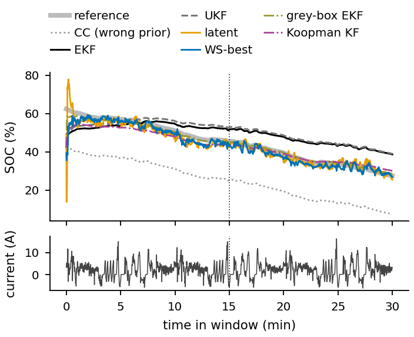
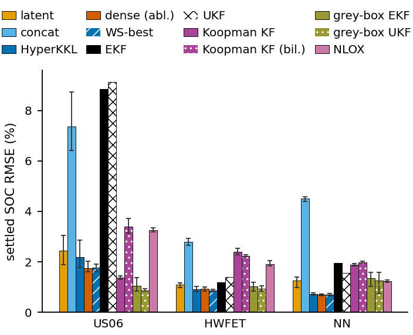

# Real-data experiment: battery SOC estimation on held-out drive cycles

Panasonic 18650PF cell (Kollmeyer, Mendeley DOI 10.17632/wykht8y7tg.1, CC BY 4.0; `DATA.md`).
Pre-registration: `DESIGN.md` (main design written before any training or evaluation; Addendum A on
data-driven baselines written before they were fitted). Numbers: `results.json`. Code:
`hyperkkl/realdata.py`, `realdata_run.py`, `realdata_baselines.py`, `realdata_report.py`; tests
`tests/test_realdata.py` (10 pass). Figures: `figures/` (png + pdf).

**HyperKKL** below = the low-rank hypernetwork decoder (`lora` code path, rank r = 4), the paper's
single weight-space method (author decision, made after the pre-registration). `hyper` (dense
generator) is an ablation. **WS-best** = the pre-registered choice: per seed, lora or hyper by
validation SOC RMSE (lora for seeds 0 and 1, hyper for seed 2).

## Headline table (25 degC, held-out drive cycles, prior SOC 20 % off)

Settled SOC RMSE [%] (t >= 15 min of each 30-min window). Seeded methods: mean ± sd over 3 seeds.

| method | US06 | HWFET | NN | validation (Cycle 4) |
|---|---|---|---|---|
| **HyperKKL (lora, r = 4)** | 2.18 ± 0.59 | 0.91 ± 0.11 | 0.73 ± 0.04 | 0.75 |
| WS-best (pre-registered) | 1.76 ± 0.15 | **0.86 ± 0.05** | **0.69 ± 0.04** | **0.71** |
| hyper (dense, ablation) | 1.75 ± 0.25 | 0.93 ± 0.08 | 0.69 ± 0.03 | 0.77 |
| latent (input in the latent dynamics) | 2.44 ± 0.58 | 1.09 ± 0.10 | 1.25 ± 0.22 | 1.34 |
| concat | 7.37 ± 1.22 | 2.80 ± 0.14 | 4.51 ± 0.11 | 4.11 |
| autonomous (no input) | 31.5 ± 2.7 | 15.5 ± 0.6 | 31.1 ± 1.6 | 23.1 |
| grey-box UKF (ECM + learned residual) | **0.87 ± 0.06** | 0.94 ± 0.11 | 1.25 ± 0.44 | 0.86 |
| grey-box EKF (ECM + learned residual) | 1.05 ± 0.29 | 1.03 ± 0.18 | 1.35 ± 0.29 | 0.97 |
| Koopman KF (EDMD, linear) | 1.38 ± 0.07 | 2.41 ± 0.14 | 1.87 ± 0.04 | 2.32 |
| Koopman KF (bilinear) | 3.39 ± 0.29 | 2.24 ± 0.04 | 1.99 ± 0.04 | 3.13 |
| NLOX | 3.24 ± 0.10 | 1.92 ± 0.11 | 1.23 ± 0.04 | 1.30 |
| EKF, identified 2-RC ECM (tuned) | 8.85 | 1.19 | 1.95 | 3.25 |
| UKF, same model (tuned) | 9.13 | 1.39 | 1.55 | 3.10 |
| coulomb counting from the wrong prior | 20.0 | 20.0 | 20.0 | 20.0 |

Episodes: 30-min windows every 5 min through each full discharge (US06 11 windows, HWFET 40,
NN 34), each run from prior SOC0 + 0.2 and/or SOC0 - 0.2 (whichever stays in [0, 1]). All
model-based filters (EKF, UKF, grey-box) have Q/R tuned on the validation cycle.

## Decisions (95 % moving-block-bootstrap CI over windows; a cycle counts only if the CI excludes 0 AND all 3 seeds agree; verdict needs >= 2 of 3 cycles)

Paired settled-RMSE difference, method minus comparator, % SOC: mean [CI] (per-seed means).

**HyperKKL (lora, r = 4): author's single-method re-reading of H1 / H2** (the pre-registered rule names WS-best):

| comparison | US06 | HWFET | NN | verdict |
|---|---|---|---|---|
| H1: HyperKKL - tuned EKF | -6.15 [-7.76, -4.07] (-6.9, -7.1, -6.0) | -0.35 [-0.59, -0.22] (-0.28, -0.38, -0.17) | -1.23 [-1.71, -0.80] (-1.21, -1.26, -1.18) | **HyperKKL beats EKF, 3/3** |
| HyperKKL - tuned UKF | -6.47 [-8.01, -4.59] | -0.42 [-0.76, -0.16] | -0.87 [-1.35, -0.51] | beats UKF, 3/3 |
| H2: HyperKKL - latent | -0.28 [-0.42, -0.17] (-1.13, -0.64, **+0.97**) | -0.18 [-0.19, 0.02] (-0.21, -0.36, **+0.04**) | -0.45 [-0.66, -0.21] (-0.63, -0.30, -0.61) | **inconclusive** (1/3: NN; on US06 and HWFET seed 2's lora is worse than latent) |
| HyperKKL - hyper (ablation) | +0.36 [0.02, 0.53] (-0.12, 0.16, 1.25) | 0.00 [-0.07, 0.08] | +0.04 [0.01, 0.07] | no difference by the rule |

**Pre-registered (WS-best):**

| comparison | US06 | HWFET | NN | verdict |
|---|---|---|---|---|
| H1: WS-best - tuned EKF | -6.50 [-8.31, -4.04] (-6.9, -7.1, -7.3) | -0.41 [-0.66, -0.29] (-0.28, -0.38, -0.34) | -1.27 [-1.76, -0.83] (-1.21, -1.26, -1.29) | **WS-best beats EKF, 3/3** |
| H2: WS-best - latent | -0.63 [-0.72, -0.21] (-1.13, -0.64, -0.28) | -0.24 [-0.26, -0.03] (-0.21, -0.36, -0.13) | -0.49 [-0.71, -0.23] (-0.63, -0.30, -0.73) | **weight-space beats latent, 3/3** |

**Addendum A (pre-stated before fitting): vs the best data-driven baseline per test cycle** (best =
lowest seed-mean settled RMSE on that test cycle, an oracle choice that favours the baselines):

| comparison | US06 | HWFET | NN | verdict |
|---|---|---|---|---|
| WS-best - best data baseline | grey-box UKF: **+0.85** [0.79, 0.95] (+0.98, +0.91, +0.78) | grey-box UKF: -0.18 [-0.39, 0.21] (+0.08, -0.25, -0.08) | NLOX: -0.49 [-0.69, -0.28] (-0.53, -0.51, -0.56) | **inconclusive** (baseline better on US06, WS-best on NN, tie on HWFET) |
| HyperKKL - best data baseline | grey-box UKF: **+1.20** [0.76, 1.46] (+0.98, +0.91, +2.03) | grey-box UKF: -0.12 [-0.31, 0.27] | NLOX: -0.45 [-0.64, -0.26] (-0.53, -0.51, -0.44) | **inconclusive** (same pattern) |
| WS-best - grey-box UKF (validation-chosen baseline) | +0.85 (baseline better) | -0.18 (tie) | -0.46 [-1.10, -0.07] (-0.85, -0.74, -0.10) | inconclusive (1 : 1) |
| HyperKKL - grey-box UKF (validation-chosen) | +1.20 (baseline better) | -0.12 (tie) | -0.42 [-1.06, -0.05] (-0.85, -0.74, **+0.02**) | baseline better on 1, tie on 2 |

## What this says

1. **Learned beats the model-based filters on an incomplete model (C3), on hardware.** The
   identified constant-parameter 2-RC ECM fits training-cycle voltage to 23-37 mV but test cycles
   only to 56-72 mV. On aggressive US06 the EKF/UKF settle on a SOC biased by ~+8 % (they explain
   a voltage error they cannot model by moving SOC); HyperKKL is 4-5x more accurate there and
   better on every test cycle, for every seed.
2. **But the same data used as a learned residual on the model is at least as good.** The
   grey-box filters (the same ECM + a 4.9k-parameter MLP residual fitted to one-step transitions
   of the same training data, inside the unchanged EKF/UKF) remove most of the model error: they
   beat HyperKKL clearly on US06 (0.87-1.05 % vs 2.18 %), tie on HWFET, and lose on NN (1.25-1.35
   vs 0.73 %). By the pre-stated rule, HyperKKL / WS-best vs the best data-driven baseline is
   inconclusive. The pure data-driven baselines (Koopman KF, NLOX) are worse than HyperKKL on
   HWFET and NN; the linear Koopman KF is better on US06 (1.38 %).
3. **Where the input enters (C1).** The simulated ordering holds: weight-space (lora, hyper) <
   latent < concat << autonomous on every test cycle, at matched conditioner budgets (139.6k-141.5k
   parameters, same sfm context). The margin over latent is small (0.2-0.6 % SOC); it passes the
   pre-registered rule for WS-best (3/3), but for HyperKKL (lora alone) only on NN, because seed 2's
   lora is worse than latent on US06 (+0.97) and marginally on HWFET (+0.04). Lora and hyper are
   indistinguishable by the rule.
4. **Horizon.** On whole discharges from full charge (prior 80 %, RMSE over t >= 15 min) the
   filters have hours to converge: HyperKKL vs EKF vs grey-box EKF: US06 2.73 / 6.98 / 0.37,
   HWFTa 0.78 / 0.80 / 1.04, HWFTb 1.03 / 0.75 / 1.43, NN 0.74 / 0.66 / 0.78. On the mild cycles
   the learned advantage over the EKF is faster convergence (median time to stay within 5 %:
   HyperKKL 0.5-0.9 min vs EKF 6.7-6.8 min on HWFET/NN), not long-run accuracy. The grey-box
   filters converge fastest (0.1-0.2 min).
5. **Temperature shift (0 degC, everything trained / identified at 25 degC): the learned
   observers fail.** Settled RMSE: HyperKKL 9.9-16.0 % on all 9 cycles; EKF 3.6-22.2 %; grey-box
   EKF 1.1-4.4 % (best on every cycle; significantly better than HyperKKL on 9/9). The model's
   explicit temperature dependence (Arrhenius R(T)) extrapolates; the learned decoders, which
   never saw 0 degC data, do not. The Koopman KF (7.8-20.8 %) and NLOX (9.1-20.9 %) also fail.
   `figures/rmse_test0.png`.

Paper-ready reading: on real hardware, learned KKL with weight-space input conditioning clearly
beats the standard BMS filters (EKF/UKF) built on an identified but incomplete equivalent-circuit
model, at the training temperature. It does not beat a grey-box filter that spends the same
training data on a residual correction of that model, and it does not extrapolate to an unseen
temperature, where the physics model (and the grey-box filter built on it) does.

## Design summary (full text: DESIGN.md)

- Input u = current (discharge +, 1 s ZOH bin means); y = (case temperature rise, BMS voltage channel:
  bin-mean terminal voltage - 3.7 V behind the plant's 2 s acquisition filter, applied in software);
  target SOC = 1 + Ah_lab / Q, Q = 2.995 Ah (C/20 capacity).
- Split by drive cycle at 25 degC: train Cycle 1-3, UDDS, LA92; validation Cycle 4; test US06,
  HWFET (two runs), NN. Disjoint files and absolute time intervals (`check_split`). Disclosed: the
  Cycle 1-4 mixes contain US06/HWFET/NN segments and NN contains US06/LA92 portions, so the test is
  sequence OOD (order, dwell, pure repetition of one profile), not strictly new waveform shapes.
- Learned KKL: the paper's default recipe (nz = 7, alpha = 1.3/min so that dt = 1 s passes the design
  gate, sfm context, budget 140k, lora rank 4, 3000 phase-2 steps, seeds 0-2). Phase 1 (T0 / T0+ with
  the PDE term) on the identified ECM (simulated zero-input episodes, collocation states, and the
  training currents replayed on the model). Phase 2 = the unchanged `train.phase2` on real windows
  with the loss on the labelled states only (SOC, dT, Vm; `realdata.masked_scales`, tested).
- Filters: unchanged `observers.EKF` / `observers.UKF` on the identified ECM; Q, R from a 72-point grid
  scored on the validation cycle with the same wrong-prior protocol (oracle-tuned, as `ekf_oracle`).
- Data-driven baselines (`baselines_data.py`, unchanged code; Addendum A), fitted per seed on the
  learned observers' real training data (each training recording once = the union of the training
  windows, 68,939 transitions; validation = Cycle 4, 12,105 transitions). Unlabelled V1, V2: the
  state is the same x as for the learned observers, with V1, V2 = the identified model's replay of
  the measured current. The grey-box residual's V1/V2 targets are therefore the model's own replay
  (validation R^2 of the residual: SOC ~0, V1 0.95, V2 0.96, dT 0.01, Vm 0.89; the V1/V2 part only
  corrects replay-vs-measured-temperature differences; the useful correction is on Vm). The Koopman
  model learns V1/V2 dynamics that are the model's. NLOX uses the masked loss. Noise tuning on
  validation: grey-box EKF/UKF on the EKF's grid; Koopman KF: Q x {0.1, 1, 10, 100}, r_Vm in {3, 10,
  30, 100} mV.
- Statistics: per-window paired differences averaged over prior signs and seeds; 95 % moving-block
  bootstrap (block 30 min, 10 000 resamples) and per-seed means.

## Limitations

1. **Reference SOC is coulomb counting** (the standard in this literature, and the target of every
   method here), not ground truth: tester current-sensor error (own integral vs lab Ah: <= 4.2 mAh,
   0.14 %), capacity measured once at C/20 on 2017-05-08, after the 25 degC drive cycles (~40 cycles
   of aging), SOC = 1 at the end of each CC-CV charge by definition. The nominal 2.9 Ah instead would
   shift the reference by up to 2.8 % SOC at the end of a discharge. Learned and grey-box methods are
   trained on this reference; the ECM uses the same Q.
2. **One cell, one test campaign.** Windows within a cycle are dependent (block bootstrap), but
   cell-to-cell variation is not sampled; US06 has only 11 windows.
3. **Temperature**: the learned observers were trained at 25 degC only; their 0 degC failure is a
   statement about extrapolation, not about multi-temperature training (not run).
4. **Model**: a constant-parameter 2-RC ECM without hysteresis or SOC-dependent resistance (a quick
   least-squares identification). A richer model would narrow the EKF's gap, as the grey-box result
   already shows.
5. **Short-window protocol favours fast convergence** (point 4 above).
6. **Tuning at grid edges**: EKF r_Vm (0.1 V, flat: 3.25 vs 3.30 %), grey-box EKF/UKF q_SOC (1e-4,
   lower edge) and r_Vm (0.1 V, upper edge), Koopman KF Q scale (0.1, lower edge) and r_Vm (0.1 V,
   upper edge). The grids were pre-registered; a wider grid could improve these baselines further,
   which would strengthen the grey-box conclusion, not weaken it.
7. The learned estimate has sample-level ripple (±1-2 % SOC); no smoothing was applied to any method.

## Deviations from DESIGN.md

- Filters were run on GPU with the whole Q/R grid as one batch (per-episode Q, R matrices broadcast
  through the unchanged filter code; `test_grid_filter_equals_individual_filters`), because the
  CPU was saturated by the parallel GPU wave. Implementation only; same grid, same score.
- Phase-1 simulations use clean outputs and no process noise (not specified in DESIGN.md).
- The headline method was renamed after the pre-registration: HyperKKL = lora (r = 4) (author
  decision); its H1/H2 verdicts are reported as a re-reading, next to the pre-registered WS-best ones.
- Not run: the strict shape split (train UDDS + LA92 only), the voltage-residual alarm,
  multi-temperature training.
